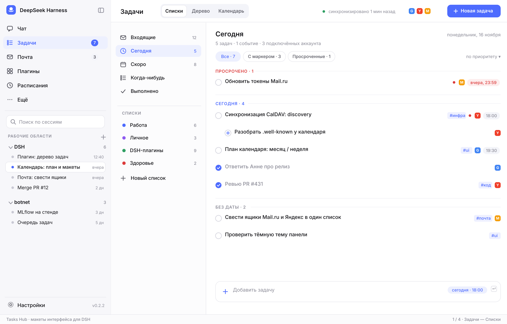

# dsh-task-hub

**Tasks, a calendar and a unified mailbox as one workspace in the DeepSeek Harness left sidebar.**

Плагин для [DeepSeek Harness](https://github.com/deepseek-ai/deepseek-harness): дерево задач, списки,
календарь и единая почта — отдельный раздел в левой навигации, рядом с «Чатом» и «Плагинами».

> **Статус: M3 (pull) — локальные задачи, календарь и импорт CalDAV.** Списки, дерево, календарь
> (месяц / неделя / повестка) и подключение аккаунтов Яндекс / Mail.ru / другой CalDAV: события
> импортируются в календарь и показываются только для чтения. Обратной записи (push) и Google пока нет.



## Что уже работает

- запись **«Задачи»** в левой навигации (`sidebar.panellist`) и панель в центральной колонке;
- **списки**: создание, цвет, счётчики; встроенные фильтры «Все / Сегодня / Скоро / Когда-нибудь / Выполнено»;
- **списки задач**: группировка по сроку (просрочено / сегодня / скоро / без даты / готово);
- **дерево**: подзадачи с отступами, сворачивание, прогресс `1/3` у родителя;
- **календарь**: вид «Месяц / Неделя / Повестка», создание события кликом по дню или часу, редактор события;
- **связь «задача ↔ событие»**: кнопка «В календарь» в задаче, выбор связанной задачи в событии, удаление задачи отвязывает событие;
- **вкладка «Аккаунты»**: подключение Яндекс / Mail.ru / любого CalDAV, выбор календарей, синхронизация и удаление аккаунта;
- **CalDAV-импорт**: discovery (principal → calendar-home → календари), REPORT time-range, разбор iCalendar (TZID, DST, all-day, DURATION), события провайдера — только чтение;
- **секреты**: пароли приложений в `secrets.json` с правами `0600`, в API и браузер не попадают;
- **редактор задачи**: название, срок, приоритет, список, метки, заметки, подзадачи, удаление;
- отметка «готово» каскадом завершает открытые подзадачи;
- **хранилище**: `$DSH_HOME/plugin-data/dsh-task-hub/tasks.json`, запись через tmp + rename, мутации сериализованы;
- **инструменты агента**: `tasks_list`, `tasks_create`, `tasks_update`, `calendar_agenda` — работают с той же доской, что и панель;
- строки интерфейса на `en` и `ru`, цвета — из токенов темы хоста.

## Дорожная карта

| Этап | Объём |
|---|---|
| M0 (сейчас) | Бандл, запись в навигации, панель, локали, упаковка |
| M1 ✅ | Локальные списки и дерево, подзадачи, сроки, теги, JSON-хранилище, инструменты агента |
| M2 ✅ | Календарь (месяц / неделя / повестка) на локальных данных, связь «задача ↔ событие» |
| M3 (pull) ✅ | CalDAV: Яндекс и Mail.ru, discovery, импорт событий в диапазоне, read-only |
| M3 (push) | Обратная запись событий и задач (VTODO), etag-конфликты |
| M4 | Google: OAuth 2.0 (loopback + PKCE), Calendar `syncToken`, Tasks API |
| M5 | Почта по IMAP: Gmail / Яндекс / Mail.ru, «письмо → задача» |
| M6 | Инструменты агента для календаря и почты, SMTP с подтверждением, полировка |

## Установка

```sh
dsh plugin --profile web add github:akkrevsky/dsh-task-hub
```

Затем жёсткое обновление страницы (Cmd/Ctrl+Shift+R). Нужен DSH 0.2.2-rc.2 или новее.

## Документация

- [План реализации и архитектура](docs/PLAN.md) — аудит существующих решений, провайдеры, модель данных, этапы.
- [Макеты](docs/mockups/index.html) — интерактивная галерея (списки, дерево, календарь, почта, архитектура).
- [Описание для страницы плагина](docs/DETAIL.md).

## Интерфейс

Панель повторяет макеты из `docs/mockups/`: шапка с вкладками «Списки / Дерево / Календарь / Аккаунты»,
статусом синхронизации и кнопкой нового элемента; левая навигация с иконками, секциями и цветными списками;
строки задач с чипами срока, меток и приоритета справа; календарь с правой колонкой (мини-месяц,
подключения, «Дальше») и быстрый ввод в нижней панели.

## Как это устроено

- Обе точки расширения — штатные: запись в навигации из слота `sidebar.panellist`, панель из keyed-слота `main`.
- Host-половина регистрирует HTTP-маршруты под `/dsh-task-hub/api` (`GET /state`, `POST /tasks`,
  `PATCH|DELETE /tasks/:id`, `POST /lists`, `PATCH|DELETE /lists/:id`, `POST /events`,
  `PATCH|DELETE /events/:id`, `GET|POST /accounts`, `POST /accounts/:id/sync`, `DELETE /accounts/:id`)
  и четыре инструмента агента; CalDAV-клиент — `caldav.js`, аккаунты и синхронизация — `accounts.js`.
- Клиент не ходит в сеть наружу: только same-origin запросы к своему Host.
- Клиентская половина — классический скрипт, регистрируемый через `window.__ModuleLoader__`: без сборки и без
  зависимостей, кроме React, который уже есть у хоста.
- Тексты идут через клиентскую локаль, цвета — через токены `--dsw-alias-*`.

## Безопасность и ограничения

- Хранилище — обычный JSON-файл в профиле; секретов в нём нет. Приватность целиком зависит от доступа к `~/.dsh`.
- API принимает только same-origin запросы браузера (кука DSH); тела ограничены 1 МБ, названия — 300 символов.
- CalDAV работает только на чтение: события провайдера импортируются, но правки в Task Hub к ним не применяются.
- Google Calendar (OAuth) и почта — следующие этапы.
- Конфликтов нет: один пользователь, один профиль.

## Лицензия

MIT — см. [LICENSE](LICENSE).
